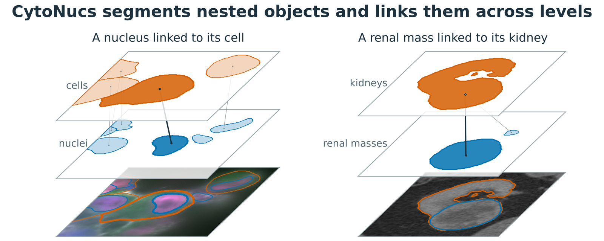
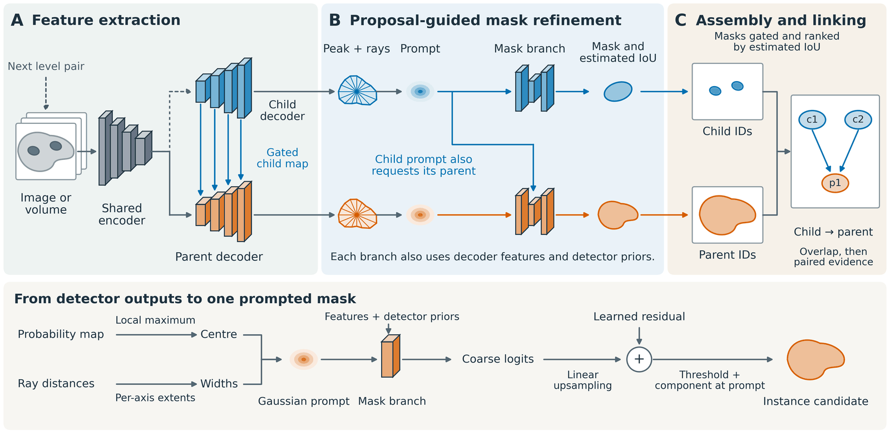
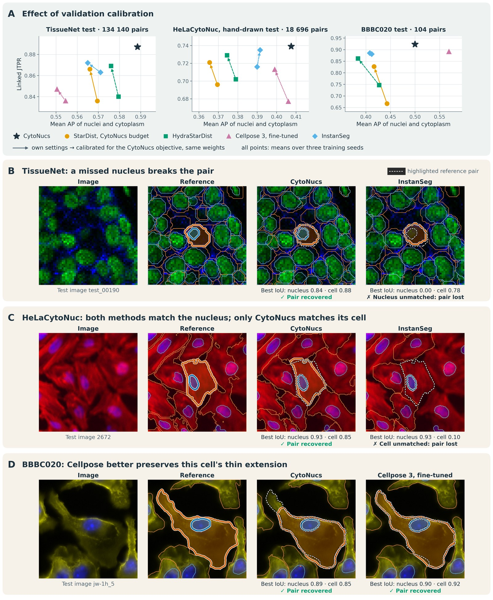
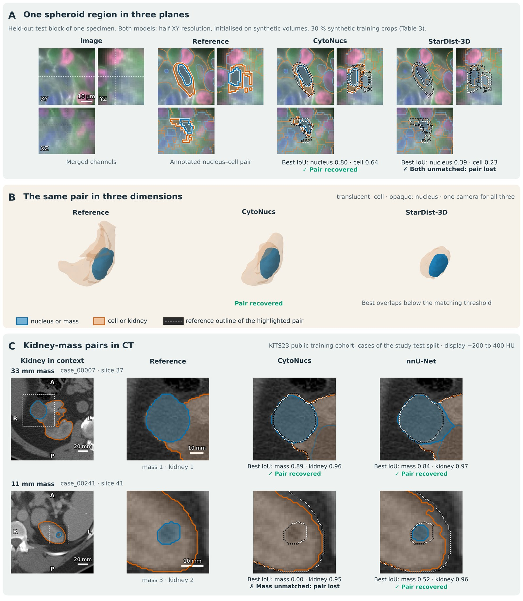
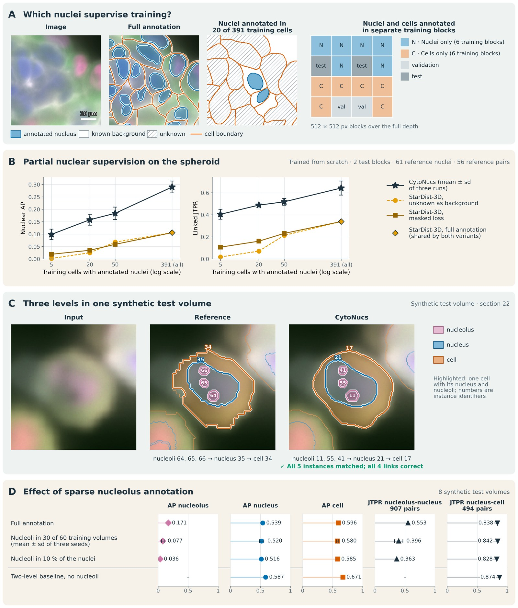
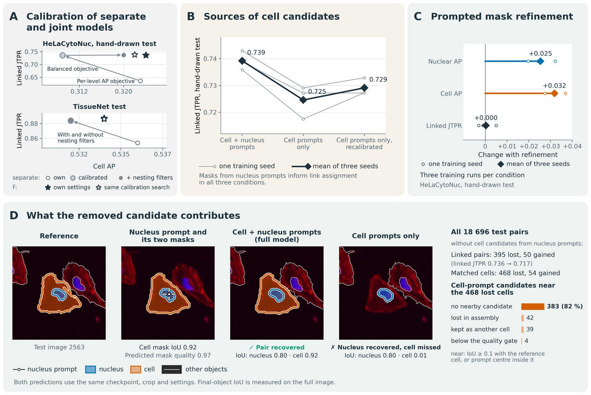
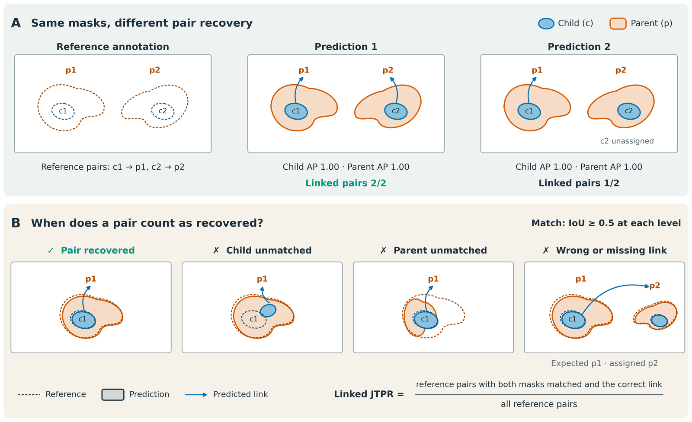

# CytoNucs: nested instance segmentation with StarDist and prompted mask refinement

CytoNucs segments objects that lie inside other objects (nuclei inside cells, tumours inside kidneys, nucleoli inside
nuclei inside cells) in 2D images and 3D volumes, including anisotropic ones. Every object of every level gets an
instance mask, and every child object is linked to its parent; a cell may hold several nuclei. Levels may be
annotated in parts of the training data only.



- [Quick start](#quick-start)
- [Installation](#installation)
- [How it works](#how-it-works)
- [Results of the paper](#results-of-the-paper)
- [Data layout](#data-layout)
- [Datasets of the paper](#datasets-of-the-paper)
- [Training](#training)
- [Inference](#inference)
- [Evaluation](#evaluation)
- [Configuration](#configuration)
- [Baselines](#baselines)
- [Reproducing the paper](#reproducing-the-paper)
- [Repository layout](#repository-layout)
- [License, citation, contact](#license-citation-contact)

## Quick start

Segment a folder of images with a pretrained model of the paper (Linux, NVIDIA GPU, Docker with the
[NVIDIA Container Toolkit](https://docs.nvidia.com/datacenter/cloud-native/container-toolkit/latest/install-guide.html)):

```bash
git clone https://github.com/podtyazhki1337/Cyto-Nucs-Stardist-2D-3D.git
cd Cyto-Nucs-Stardist-2D-3D
docker/run.sh segment helacytonuc_e7_clean my_images my_labels
```

The first run pulls the image [podtyazhki1337/cytonucs](https://hub.docker.com/r/podtyazhki1337/cytonucs) and
downloads the model from [Hugging Face](https://huggingface.co/Podtyazhki1337/cytonucs) into `models/`. It writes
`my_labels/nucleus/<name>` and `my_labels/cytoplasm/<name>` (instance labels) and `my_labels/parents/<stem>.json` (the
cell of every nucleus). `docker/run.sh models` lists the models: TissueNet, HeLaCytoNuc, BBBC020, KiTS23, the HeLa-MRC-5
spheroid, the synthetic three-level and partial-annotation models. The images need the channels the model was trained
on (see the [datasets](#datasets-of-the-paper) and the model card).

Without Docker, after the [installation](#installation):

```bash
hf download Podtyazhki1337/cytonucs --include "helacytonuc_e7_clean/*" --local-dir models
python predict.py --config models/helacytonuc_e7_clean/config.json \
    --weights models/helacytonuc_e7_clean/weights_best.weights.h5 --input my_images/ --output my_labels/
```

## Installation

**Docker.** Nothing to install besides Docker and the NVIDIA Container Toolkit. `docker/run.sh` runs any command of
this README in the image, as the current user, with `data/` (datasets), `runs/` (run folders) and `models/` of the
current folder mounted where the configurations expect them:

```bash
docker/run.sh python train_cytonucs.py configs/helacytonuc_e7_clean.json
docker/run.sh bash                     # a shell in the image
```

- Other files of the current folder are under `/work` in the container (e.g. `--config /work/my_config.json`).
- `CYTONUCS_GPUS=device=1` picks a GPU, `CYTONUCS_GPUS=none` runs on the CPU; `CYTONUCS_DATA`, `CYTONUCS_RUNS` and
  `CYTONUCS_MODELS` mount other folders.
- `docker build -t podtyazhki1337/cytonucs .` builds the image from this repository. On Docker Hub, `latest` follows
  this repository; the other tags name the commit an image was built from.
- The image holds CytoNucs, StarDist and HydraStarDist. Cellpose, InstanSeg and nnU-Net need environments of their
  own (see [Baselines](#baselines)).

**Python environment.** Python 3.10 and an NVIDIA GPU (tested on RTX A5000, 24 GB; inference also runs on the CPU,
slowly):

```bash
conda create -n cytonucs python=3.10 && conda activate cytonucs
pip install -r requirements.txt
pip install --no-deps edt      # optional: several times faster StarDist targets
```

Main versions: TensorFlow 2.18 (Keras 3), StarDist 0.9.1, CSBDeep 0.8.1, NumPy 1.26 (the exact set of the paper is
`docker/constraints.txt`).

## How it works

CytoNucs keeps StarDist [1, 2] at its core and adds a promptable mask refinement:



1. **Proposals.** A shared U-Net predicts, for every level, a StarDist object probability and star-convex ray
   distances. The peaks of the probability are the object proposals.
2. **Prompted refinement.** Each proposal becomes a prompt: a Gaussian at the peak, sized by its rays. A light
   refinement network reads the decoder features gated by the prompt and predicts the mask of that one object, as
   promptable segmentation models do with a point prompt [3]. A full-resolution head sharpens the mask and a
   quality head scores it. The mask is not limited to a star-convex shape.
3. **Nesting.** A nucleus prompt yields the nucleus and the cell that contains it; cell prompts find the remaining
   cells. Masks are written in order of quality, a child stays inside its parent, and the prompt that found a child
   also gives its link to the parent.
4. **Hierarchies.** Three or more levels run as a chain of adjacent pairs through the same network.

Training adds to the StarDist losses (probability BCE, ray MAE):

- a Polar IoU loss on the rays, from PolarMask [4];
- an IoU-aware probability target (the StarDist target times the Polar IoU of the predicted rays), after
  VarifocalNet [5];
- mask losses (cross-entropy and the Lovász loss [6]) and a quality loss for the refinement;
- a containment term and a within-boundary regularisation inspired by HydraStarDist [7], which tie the levels
  together;
- partial annotation: voxels or files where a level is not annotated (`training.unknown_label`,
  `training.partial_annotation`) are left out of that level's losses.

After training, the inference thresholds (proposal probability, mask threshold, quality and size gates, nesting
filters) are calibrated on the validation set for the checkpoint metric, half linked JTPR and half mean AP.

## Results of the paper

Figures of the paper (in preparation); [Evaluation](#evaluation) defines AP and linked JTPR.

**2D microscopy.** AP against linked JTPR on TissueNet, HeLaCytoNuc and BBBC020, every method at its own settings and
calibrated on validation for the same objective, and one annotated nucleus-cell pair per dataset.



**3D.** A nucleus-cell pair of the HeLa-MRC-5 spheroid in three planes and in 3D (CytoNucs and StarDist-3D), and
kidney-mass pairs in KiTS23 CT (CytoNucs and nnU-Net).



**Partial annotation and a third level.** Nuclei annotated in a few training cells, or nuclei and cells in different
blocks; nucleoli, nuclei and cells on synthetic volumes with sparse nucleolus annotation.



**Joint or separate networks, and the parts of CytoNucs.** Separate nucleus and cell networks against the joint model
at matched calibration, the sources of cell candidates, and the gain from the prompted mask refinement.



## Data layout

One folder per split. Each holds the images and, for every level of `model.levels` (inner level first), its instance
label images under the same file names:

```
dataset/
├── train/
│   ├── images/              2D: YX or YXC; 3D: ZYX or ZYXC (TIFF)
│   ├── nucleus_masks/       one instance label image per image (0 = background)
│   ├── cytoplasm_masks/
│   └── assignments/         optional: {nucleus id: cell id} per image (JSON); derived by overlap if missing
├── val/
└── test/
```

- Other level names work the same way: `model.levels: ["mass", "kidney"]` reads `mass_masks/`, `kidney_masks/` and
  `assignments_mass_kidney/`. Three levels `["nucleolus", "nucleus", "cytoplasm"]` also read
  `assignments_nucleolus_nucleus/`.
- Partial annotation: a voxel that carries `training.unknown_label` (e.g. 65535) in a level's training mask is left
  out of that level's losses; a training file without a level's mask folder entry does not annotate that level.
- Scoring with an ignore region: `<split>/<level>_unknown/<name>` (non-zero = unknown); predicted objects lying
  mostly inside it are left out of the scores.
- Spatially split 3D volumes (one large volume cut into train / val / test blocks) are made by
  `dataset_prep/make_spatial_split_patches.py` and scored on whole blocks with `evaluate_blocks.py`.

## Datasets of the paper

`dataset_prep/` writes the layout above. The configurations in `configs/` expect the results under `data/`.

| Dataset | Levels | Download | Conversion |
|---|---|---|---|
| TissueNet v1.1 [10] | nucleus, cell (2D, nuclear + membrane channels) | [DeepCell datasets](https://datasets.deepcell.org/) (`tissuenet_v1.1_{train,val,test}.npz`, non-commercial licence) | `python dataset_prep/tissuenet_to_cytonucs.py --raw data/TissueNet/raw --output data/TissueNet/cytonucs` |
| HeLaCytoNuc [11] | nucleus, cell (2D RGB) | [RODARE 10.14278/rodare.3001](https://doi.org/10.14278/rodare.3001) (CC BY 4.0) | `python dataset_prep/helacytonuc_to_cytonucs.py --extracted data/HeLaCytoNuc/extracted --output data/HeLaCytoNuc/cytonucs`, then the clean-up below |
| BBBC020 [12] | nucleus, cell (2D, DAPI + CD11b) | [Broad Bioimage Benchmark Collection](https://bbbc.broadinstitute.org/BBBC020) | `python dataset_prep/bbbc020_to_cytonucs.py --raw data/BBBC020/raw --output data/BBBC020/cytonucs_native --factor 1` |
| KiTS23 [13] | mass (tumour or cyst), kidney (3D CT) | [KiTS23 repository](https://github.com/neheller/kits23) (CC BY-NC-SA 4.0) | `python dataset_prep/kits23_to_cytonucs.py --kits data/KiTS23/kits23 --output data/KiTS23/cytonucs_3x078`, then `python dataset_prep/subset_view.py --dataset data/KiTS23/cytonucs_3x078 --output data/KiTS23/cytonucs_3x078_val16 --keep val:16` |
| HeLa-MRC-5 spheroid [15] | nucleus, cell (3D) | [figshare 10.6084/m9.figshare.24982227](https://doi.org/10.6084/m9.figshare.24982227) (Piccinini and Diosdi, 2024; GPL 3.0+): acquisition 012, the four source RGB stacks in `channels.zip`, the nuclear and whole-cell instance labels in `masks2.zip` (files ending in `ch00_mask.tif` and `ch03_mask.tif`) | `python dataset_prep/hela_spheroid_from_figshare.py --download data/Cytonucs_Emese_Hela/figshare --output data/Cytonucs_Emese_Hela` (downloads the record and merges the four stacks into one RGB volume), then the spatial split below |
| Synthetic | nucleolus, nucleus, cell (3D) | [Hugging Face: Podtyazhki1337/cytonucs-synthetic](https://huggingface.co/datasets/Podtyazhki1337/cytonucs-synthetic) (with the partly annotated variants) | or generate with `dataset_prep/synthetic/` (see its README) |

**HeLaCytoNuc clean-up.** The CellProfiler masks of part of the training and validation images miss most cells, and
three hand-drawn test masks are 8-bit with more than 255 nuclei. The cleaned split of the paper is a hard-link view
(no extra disk space):

```bash
python dataset_prep/drop_incomplete_annotation.py --dataset data/HeLaCytoNuc/cytonucs \
    --output data/HeLaCytoNuc/cytonucs_clean --splits train val val_all test_cellprofiler
python dataset_prep/fix_label_overflow.py --dataset data/HeLaCytoNuc/cytonucs_clean --splits test
```

They write `excluded.json` (the dropped images, with annotated and visible nuclei) and `label_overflow.json` (the
relabelled test masks) at the top of the view.

**HeLa-MRC-5 spheroid split.** The merged volume is cut into 16 XY blocks of 512 px, each block in one split over
the full Z (`patches_split_hela`). `--blocks` keeps the blocks of the paper (`dataset_prep/hela_spheroid_blocks.json`:
12 train, 2 val, 2 test blocks). `add_train_regions.py` adds the whole volume for training crops inside the train
blocks. `downscale_split.py` writes the copy at half XY resolution that the 3D models of the paper are trained on
(`patches_split_hela_xy2`):

```bash
python dataset_prep/make_spatial_split_patches.py --image data/Cytonucs_Emese_Hela/images \
    --nucleus-mask data/Cytonucs_Emese_Hela/nuc_masks --cytoplasm-mask data/Cytonucs_Emese_Hela/cyto_masks \
    --output data/Cytonucs_Emese_Hela/patches_split_hela --blocks dataset_prep/hela_spheroid_blocks.json
python dataset_prep/add_train_regions.py --dataset data/Cytonucs_Emese_Hela/patches_split_hela
python dataset_prep/downscale_split.py --dataset data/Cytonucs_Emese_Hela/patches_split_hela \
    --output data/Cytonucs_Emese_Hela/patches_split_hela_xy2
```

From the figshare files, these commands give the paper's merged volume, masks, val and test tiles and whole-volume
training regions, byte for byte (at both resolutions). The 3D models train on crops of the whole volume
(`training.train_region_crops`) and are scored on the whole held-out blocks, so they use the same data. The train
tiles differ slightly: a few almost empty tiles are kept at random, and the augmented copies differ, because the
random generator of the paper's run also served in-house volumes. They enter only the geometry measured at the start
of training and the train-side metric.

**Partial annotation variants** (paper, Tables 6 and 7): `dataset_prep/sparse_annotation.py` (nuclei in k cells),
`dataset_prep/hide_level_by_blocks.py` (each level in different blocks), `dataset_prep/sparse_tiles.py` (levels
dropped or sparse in tile datasets, e.g. the synthetic data).

## Training

Start from `config_cytonucs.json` (the options a user sets) or from a configuration of the paper in `configs/`, set
`data.dataset_dir`, and run:

```bash
python train_cytonucs.py my_config.json
```

The run folder `output.basedir/experiment.name` (e.g. `runs/my_run/`) holds:

| File | Content |
|---|---|
| `weights_best.weights.h5` | best checkpoint by the full validation (checkpoint metric: `loss_params.checkpoint_w_jtpr` x linked JTPR + the rest x mean AP) |
| `weights_best.weights.h5.inference.json` | inference settings calibrated on val for these weights (read automatically) |
| `weights_best_val_loss.weights.h5`, `weights_epoch_<N>.weights.h5` | best by validation loss; the last epoch (to resume) |
| `geometry.json` | ray sets, grids and data settings measured on the training labels; needed at inference |
| `history.json`, `final_results.json`, `visualizations/` | training history, final validation, example overlays |

The levels and their order, the image channels, sparse annotation and the number of training images kept in memory
(15 % of the host memory) are read from the training data when the configuration leaves them out. Training resumes
from the last epoch checkpoint with `training.resume_from_checkpoint`; `training.init_weights` fine-tunes from
another run (with `training.init_weights_partial: true` from a run of another architecture, e.g. a two-level
pretraining for a one-level network: every layer with the same name and shapes is loaded, the rest starts fresh).

## Inference

`predict.py` segments a folder of images (see [Quick start](#quick-start)); 2D images and 3D volumes are tiled as
StarDist does (in 3D, training-size windows along Z blended with Hann weights). The settings calibrated for the
weights are used; any of them can be set in the `inference` section of the configuration instead (e.g.
`prob_thresh_nucleus`, `mask_thresh_cytoplasm`, `quality_gates_override`).

## Evaluation

```bash
# a model on a split with annotation (per-image records; --predictions also saves the labels and links)
python score_hierarchy.py --config my_config.json --weights runs/my_run/weights_best.weights.h5 --split test \
    --output runs/my_run/hierarchy_test.json --predictions runs/my_run/predictions_test
# saved labels of any method (links by overlap unless <predictions>/parents/ holds them)
python score_predictions.py --data dataset --predictions OTHER_METHOD/predictions --split test --jtpr-ious 0.3 0.7
# whole held-out blocks of a spatially split 3D volume
python evaluate_blocks.py --config my_config.json --weights runs/my_run/weights_best.weights.h5 --splits test val
```

- **AP**: the mean over IoU 0.50-0.95 of TP / (TP + FP + FN) of every level, counts pooled over the images.
- **Linked JTPR**: for every adjacent pair of levels, the share of annotated child-parent pairs whose two objects
  are both found (IoU >= 0.5) and linked to each other in the prediction. The score files also give why the others
  are missed (`fail_inner`, `fail_outer`, `fail_link`) and, with `--jtpr-ious`, the JTPR at other IoU thresholds.
- **Metrics of the HydraStarDist paper** [7]: IoUR, AP and the joint TP rates over children and over parents at
  τ = 0.1-0.9 (`paper_<pair>`), for comparison with that paper.



Scores are kept per image (`records`), so bootstrap intervals and breakdowns are computed without predicting again.
`calibrate_inference.py` calibrates the `auto` inference settings of a configuration for given weights again (e.g.
for an inference variant).

## Configuration

`config_cytonucs.json` lists the options a user sets. Everything else comes from the method (`METHOD_SETTINGS` in
`cytonucs_config.py`: architecture, optimiser and learning-rate schedule, augmentation, mask assembly, calibration
grids; the same in every run of the paper) or follows from the dimensionality (`NDIM_SETTINGS`). A configuration that
still sets such a key keeps its value, with a notice where it differs; keys that no longer exist are ignored with a
notice.

| Section | Option | Meaning |
|---|---|---|
| model | `ndim`, `levels` | dimensionality; nested levels, inner first (read from the `<level>_masks` folders when left out) |
| model | `unet_n_filter_base` | width of the shared U-Net |
| training | `train_patch_size`, `image_batch_size`, `prompts_per_crop` | crop size, crops per step, prompts per crop |
| training | `train_epochs`, `steps_per_epoch`, `lr_decay_steps` | schedule |
| training | `object_crop_shares` | [inner, outer]: shares of the crops centred on one object of that level; the rest at random positions |
| training | `unknown_label`, `partial_annotation` | label of unannotated voxels; files that do not annotate a level |
| training | `mask_prompt_fraction`, `mask_prompt_start_epoch` | share of the prompts that also carry the model's own first mask, from that epoch (trains a second refinement pass) |
| augmentation | `negative_prompt_prob`, `negative_prompt_inside_outer` | share of empty-target prompts; share of them placed in an outer object where no inner object lies |
| loss_weights, loss_params | `lambda_*`, `*_weight`, `prob_iou_aware` | loss weights, e.g. `dist_polar_iou_weight` (Polar IoU on the rays), `prob_iou_aware` (IoU-aware target), `lambda_wbr` (within-boundary regularisation) |
| inference | `prob_thresh_*`, `mask_thresh_*`, `inner_min_inside_outer`, `outer_min_inner_share` | `auto` (default): calibrated on val after training; or a number |
| inference | `quality_gates_override` | per-level quality / size gates replacing the calibrated ones (e.g. from `paper/recalibrate_gates.py`) |
| inference | `refinement_iterations` | refinement passes per candidate (needs `mask_prompt_fraction` in training) |
| inference | `outer_from_inner_prompts` | an inner prompt's outer mask is also an outer candidate (default true; false is an ablation) |
| inference | `outer_own_prompts` | the outer head prompts objects of its own (default true; false is an ablation: every outer object comes from an inner prompt) |
| inference | `semantic_scores`, `semantic_min_*` | mean semantic foreground probability of every object; objects below the minimum are removed |
| inference | `skip_covered_prompts`, `refinement_windows`, `refinement_roi_stride` | speed of the prompt refinement |

## Baselines

All baselines train on the same splits and are scored by `score_predictions.py` (or their own scorer with the same
metrics). Changes to third-party code are marked in the code.

| Baseline | Script | Environment |
|---|---|---|
| StarDist [1, 2], one model per level (2D / 3D) | `baselines/stardist3d/run_files.py` (datasets of one file per image), `run_fullres.py` (spatially split volume) | this one |
| HydraStarDist [7] and HydraStarDist+WBR | `baselines/hydrastardist/run_hsd.py [--wbr]`; the authors' package is vendored with its BSD licence. The released WBR layer has zero gradient (`check_wbr_gradient.py`); `--wbr` trains with the paper's WBR made differentiable | this one |
| Cellpose [8] (version 3), fine-tuned and pretrained | `baselines/cellpose/run_cellpose.py` (2D), `run_cellpose3d.py`, `run_cellpose3d_files.py` (3D) | `pip install cellpose==3.*` |
| InstanSeg [9], trained and pretrained | `baselines/instanseg/run_instanseg.py` (one model for nuclei and cells, its own links) | `pip install instanseg-torch` (0.1.2 tested) |
| nnU-Net v2 [14] (KiTS23) | `baselines/nnunet/prepare_kits.py`, `to_instances.py` | `pip install nnunetv2` (2.6.4 tested) |

Each script prints its usage with `--help`; predictions go to `runs/<method>/<name>/predictions` by default. The trained
baselines of the paper (seed 0) are on Hugging Face:
[Podtyazhki1337/cytonucs-baselines](https://huggingface.co/Podtyazhki1337/cytonucs-baselines).

## Reproducing the paper

- `configs/` holds the configuration of every model reported in the paper; `configs/README.md` lists them with
  their data and role (final models, ablations, partial annotation, development of the recipe).
- `paper/` holds the scripts that only the paper's analyses need; `paper/README.md` maps the tables to the scripts.

## Repository layout

```
train_cytonucs.py            training entry point (one JSON configuration)
predict.py                   segmentation of a folder of images with a trained model
score_hierarchy.py           AP, linked JTPR and the HydraStarDist-paper metrics of a model on a split
score_predictions.py         the same scores for saved labels of any method
evaluate_blocks.py           scores on whole held-out blocks of a spatially split 3D volume
score_native_resolution.py   scores of a model trained on a downscaled copy, against the native annotation
calibrate_inference.py       the 'auto' inference settings calibrated on val for given weights
config_cytonucs.json         configuration template: the options a user sets
cytonucs_config.py           configuration loading and validation, ray sets and grids from the object geometry
cytonucs_model.py            U-Net, StarDist heads, prompted refinement and full-resolution heads
cytonucs_losses.py           losses and the StarDist targets
cytonucs_data_generator.py   crop sampling, augmentation, prompts and targets
cytonucs_trainer.py          training loop, checkpoints, full validation
cytonucs_inference.py        proposals, batched / windowed prompt refinement, tiling, mask assembly
cytonucs_calibration.py      calibration of the inference settings after training
cytonucs_hierarchy.py        hierarchies of three or more levels
cytonucs_postprocess.py, cytonucs_fine_mask.py, cytonucs_mask_quality.py, cytonucs_geometry.py,
cytonucs_containment_helper.py, cytonucs_refinement_audit.py, cytonucs_runtime.py, cytonucs_data_settings.py,
cytonucs_gpu_setup.py        helpers
configs/                     configurations of the paper's models
baselines/                   StarDist, HydraStarDist, Cellpose, InstanSeg and nnU-Net on the same splits
dataset_prep/                converters of public datasets, clean-up, splits, partial annotation, synthetic data
paper/                       analyses of the paper (inference timing, operating points, semantic gate, ...)
Dockerfile, docker/          the Docker image, its entry point (docker/cytonucs) and docker/run.sh
```

## License, citation, contact

Code: MIT licence (`LICENSE`); the vendored HydraStarDist package keeps its BSD-3-Clause licence. The datasets have
licences of their own (see the table above).

The paper describing CytoNucs is in preparation; a citation will be added here.

Contact: mayurovm@gmail.com

## References

1. U. Schmidt, M. Weigert, C. Broaddus, G. Myers. Cell Detection with Star-Convex Polygons. MICCAI 2018.
   [arXiv:1806.03535](https://arxiv.org/abs/1806.03535)
2. M. Weigert, U. Schmidt, R. Haase, K. Sugawara, G. Myers. Star-convex Polyhedra for 3D Object Detection and
   Segmentation in Microscopy. WACV 2020. [arXiv:1908.03636](https://arxiv.org/abs/1908.03636)
3. A. Kirillov et al. Segment Anything. ICCV 2023. [arXiv:2304.02643](https://arxiv.org/abs/2304.02643)
4. E. Xie et al. PolarMask: Single Shot Instance Segmentation with Polar Representation. CVPR 2020.
   [arXiv:1909.13226](https://arxiv.org/abs/1909.13226)
5. H. Zhang, Y. Wang, F. Dayoub, N. Sünderhauf. VarifocalNet: An IoU-aware Dense Object Detector. CVPR 2021.
   [arXiv:2008.13367](https://arxiv.org/abs/2008.13367)
6. M. Berman, A. Rannen Triki, M. B. Blaschko. The Lovász-Softmax loss: A tractable surrogate for the optimization of
   the intersection-over-union measure in neural networks. CVPR 2018. [arXiv:1705.08790](https://arxiv.org/abs/1705.08790)
7. T. De, A. Urbanski, A. Yakimovich. Single-shot Star-convex Polygon-based Instance Segmentation for
   Spatially-correlated Biomedical Objects (HydraStarDist). arXiv 2025. [arXiv:2504.12078](https://arxiv.org/abs/2504.12078)
8. C. Stringer, T. Wang, M. Michaelos, M. Pachitariu. Cellpose: a generalist algorithm for cellular segmentation.
   Nature Methods 18, 100-106 (2021). [doi:10.1038/s41592-020-01018-x](https://doi.org/10.1038/s41592-020-01018-x)
9. T. Goldsborough et al. InstanSeg: an embedding-based instance segmentation algorithm optimized for accurate,
   efficient and portable cell segmentation. arXiv 2024. [arXiv:2408.15954](https://arxiv.org/abs/2408.15954)
10. N. F. Greenwald, G. Miller et al. Whole-cell segmentation of tissue images with human-level performance using
    large-scale data annotation and deep learning. Nature Biotechnology 40, 555-565 (2022).
    [doi:10.1038/s41587-021-01094-0](https://doi.org/10.1038/s41587-021-01094-0)
11. T. De, A. Urbanski, P. Thangamani, M. Wyrzykowska, A. Yakimovich. HeLaCytoNuc. RODARE (2024). [doi:10.14278/rodare.3001](https://doi.org/10.14278/rodare.3001)
12. V. Ljosa, K. L. Sokolnicki, A. E. Carpenter. Annotated high-throughput microscopy image sets for validation.
    Nature Methods 9, 637 (2012). [doi:10.1038/nmeth.2083](https://doi.org/10.1038/nmeth.2083)
13. N. Heller et al. The KiTS21 Challenge: Automatic segmentation of kidneys, renal tumors, and renal cysts in
    corticomedullary-phase CT. arXiv 2023. [arXiv:2307.01984](https://arxiv.org/abs/2307.01984)
14. F. Isensee, P. F. Jaeger, S. A. A. Kohl, J. Petersen, K. H. Maier-Hein. nnU-Net: a self-configuring method for
    deep learning-based biomedical image segmentation. Nature Methods 18, 203-211 (2021).
    [doi:10.1038/s41592-020-01008-z](https://doi.org/10.1038/s41592-020-01008-z)
15. F. Piccinini, A. Diosdi. 2024_Hollandi-4_Co_culture_images_and_masks. figshare (2024).
    [doi:10.6084/m9.figshare.24982227](https://doi.org/10.6084/m9.figshare.24982227)
